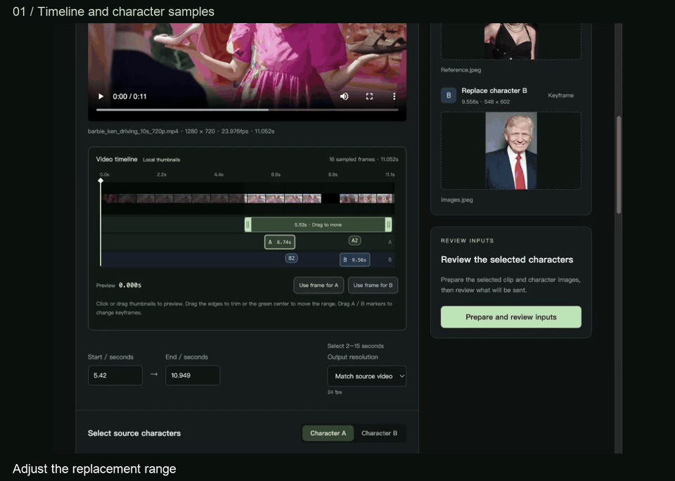
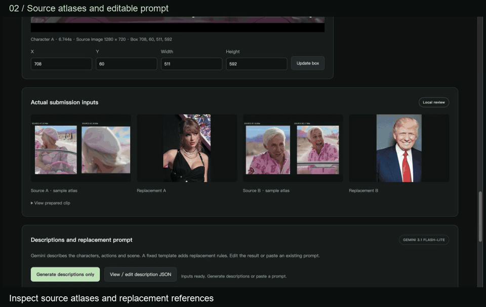
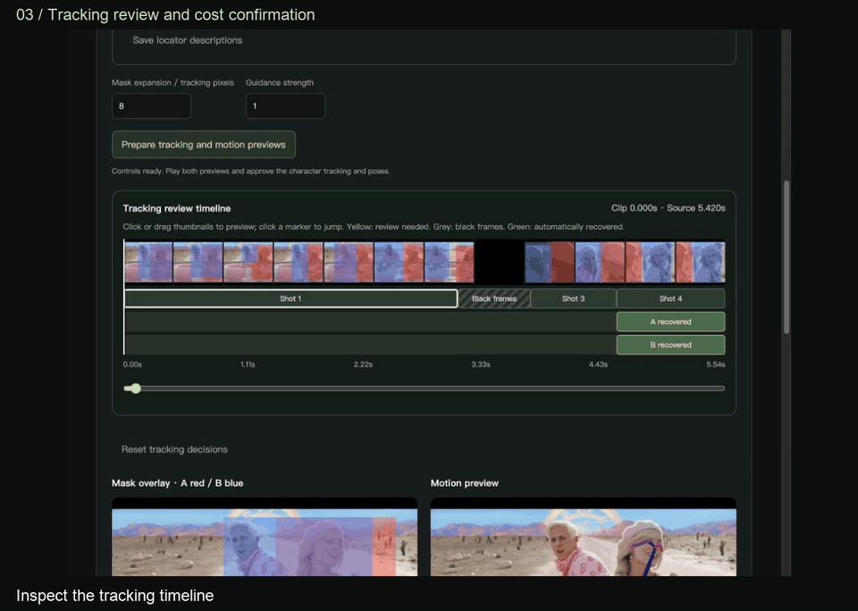

# Website walkthrough

Three short recordings of the English release interface, using the driving scene
at **5.420–10.949 seconds** with two characters. A is the driver; B is the passenger.

**No Cloud submission was made.** The last recording opens the cost dialog, leaves
its cost acceptance unchecked, and cancels. It never clicks **Submit once**.

## 1. Timeline and character samples

Adjust the replacement range, preview a frame, add a sample at the playhead, draw
the character region and switch between saved views for A and B. Each role supports
multiple source samples; a different view can help tracking recover after a cut.

[MP4 · 12 seconds](01-timeline-samples.mp4) · [GIF](01-timeline-samples.gif)

Adding samples later retains the existing prompt. The app recommends refreshing
descriptions when samples change; it does not force another Gemini job.

## 2. Source atlases and editable prompt

Inspect prepared source atlases and replacement references, open saved description
JSON, edit the prompt and save locally before continuing to tracking review.
Source descriptions locate the original people; replacement references supply the
new appearance. Keep the A/B pairing consistent throughout.

[MP4 · 11 seconds](02-inputs-prompt.mp4) · [GIF](02-inputs-prompt.gif)

Generating descriptions is optional when using existing descriptions or a prompt.
It is a separate, explicitly confirmed Cloud operation, not shown being run here.

## 3. Tracking review and cost confirmation

Scrub the tracking timeline, play saved mask and pose previews, approve the reviewed
controls, inspect the exact inputs, then open the cost dialog and **Cancel**.
Opening this dialog does not submit a Cloud job.

[MP4 · 15 seconds](03-controls-review.mp4) · [GIF](03-controls-review.gif)

If your timeline has review items, the red warning recommends adding samples and
retrying, or splitting the video into shorter replacement tasks. You can explicitly
acknowledge the warning and continue, then separately approve controls and confirm
the paid submission. This recording uses saved controls without outstanding items;
it does not demonstrate the warning override.

Recording notes

- Recorded from the actual local release website in an isolated project copy with
  no API key. Existing prepared media, source atlases and mask/pose results were
  loaded. No Gemini, EdgeTAM, DWPose or H3 inference ran for this walkthrough.
- Descriptions were manually reviewed for the driver's A / passenger's B pairing
  and used to assemble the demo prompt. The recording shows a further local edit;
  it does not claim the saved controls or an existing generated video were produced
  from that edited prompt.
- The three takes are independent. The extra sample in the first take is a UI
  demonstration; the later takes reuse their original prepared checkpoint.
- Real viewport captures retain their recorded timing, with static tails trimmed
  and explanatory captions added outside the website viewport. The MP4s are silent
  at 1280 × 912; looping GIF previews are 960 × 684. GIF/MP4 frames are resampled for
  playback compatibility, not recordings of a completed generation job.
- The historical GPU rate visible in the dialog is not a live quote. See the
  [maintainer's empirical price estimates](../../README.md#price-estimate-from-maintainer-tests)
  for observed per-run credits and the stated conversion basis.

The source footage, depicted people, reference images and generated media remain
outside the application's GPL grant. See [third-party notices](../../THIRD_PARTY_NOTICES.md#example-media).

