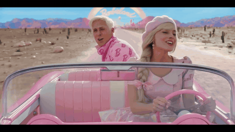
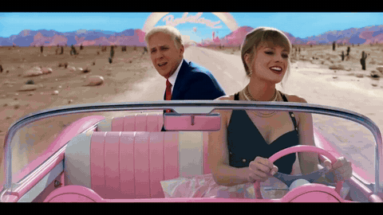

# Character replacement comparisons

Two existing H3 outputs compared with the source ranges actually submitted.

**[Open the interactive comparison](comparison.html)** — drag the divider, play/pause,
or scrub both clips together. Download this folder and open `comparison.html` locally;
the viewer itself is self-contained. On GitHub, this HTML link opens source code unless
served through a static site. Standard Markdown does not run JavaScript sliders, so
the animated wipes below provide an inline comparison.

## Studio performance

Selected source range: **6.084–13.084s** (7.000s).
Original source is on the left of the moving divider; generated content is on the right.

Separate source and generated GIFs

| Source · selected range | Generated result |
| --- | --- |
|  |  |

## Driving scene

Selected source range: **5.420–10.949s** (5.529s).
Original source is on the left of the moving divider; generated content is on the right.

Separate source and generated GIFs

| Source · selected range | Generated result |
| --- | --- |
|  |  |

GIF previews are silent, 480 × 270 at 10 fps. The interactive viewer uses
960 × 540 previews at 24 fps. Both sides share the saved clip timing, with model
padding removed. GIF timing is quantized to its frame rate; no generation was rerun.

These media examples are separate from the GPL application source package. The
application license does not grant rights to the input clips or depicted references.
